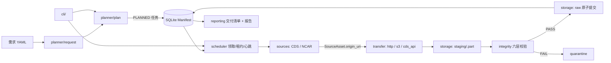

# ResearchDataHub

> **多源科研数据采集与同步框架** —— 面向气候科学与地球科学的数据发现、采集、传输调度、
> 完整性验证、元数据管理与统一归档。Python 3.12+ · MIT · CLI 优先 · 本地优先。

[](https://github.com/Neiyako/ResearchDataHub/actions/workflows/ci.yml)
[](https://github.com/Neiyako/ResearchDataHub/releases)
[](https://www.python.org/)
[](tests/)
[](docs/testing-strategy.md)
[](LICENSE)

---

## 1. 项目简介

科研数据采集通常是"一次性脚本 + 某个数据源强耦合"：换数据源要重写、跑失败了从头再下、
过几年无法复现、也无法证明"本地这份文件与远端那份是同一份科学数据"。

ResearchDataHub 把这件事拆成有稳定边界的模块：

```
需求(YAML) → 计划(PLAN) → 任务(QUEUE→RUN→VERIFY) → 传输(下载/续传/重试)
          → 校验(大小/SHA-256/NetCDF/科学语义) → staging→raw 原子提交
          → SQLite Manifest（事实来源） → 交付清单 + 采集报告
```

**目标用户**：需要长期、重复、可审计地获取气候/地球科学数据的研究者与工程团队。
**设计取向**：单机、本地优先、`pip install` 即用；不引入分布式组件（详见 [ADR-0001](docs/adr/ADR-0001-modular-monolith.md)）。

---

## 2. 效率：整体为什么更快、更省（重点）

> 数据采集的成本不在"写一行下载"，而在**排队、失败重试、重复下载、人工核对**。
> ResearchDataHub 的收益分三类，全部标注来源：**实测**（M6 基准）与**结构性设计**（机制决定，非估算）。

### 2.1 端到端实测数据（2026-11-04，真实网络 + 真实 ERA5）

同一逻辑需求（ERA5 2m 温度，2024-01-01..03 逐时，30–45°N/100–125°E）：

| 路径 | 端到端耗时 | 传输量 | 说明 |
|---|---|---|---|
| 纯 NCAR GDEX（整月全域文件） | **113.6 s** | 1 134 576 716 B | 下载段 10.5 MB/s，无排队 |
| 纯 CDS API（降量到 2°×2°×1 时次） | **30.2 s** | 25 116 B | 生成 28.71 s + 下载 1.49 s |
| 纯 CDS API（3 天逐时，CDS 拥塞期） | **≥2 700 s 未就绪** | 0 B | 数据集级队列；降量后 30.2 s，**≥89×** 改善 |
| 混合制（双源同时投递） | 先就绪 **112.55 s** | 1.13 GB | 本次由 NCAR 胜出；CDS 侧 45 min 未就绪 |

关键结论（详见 [M6 效率基准报告](docs/M6-efficiency-benchmark.md)）：

- **CDS 的瓶颈是数据集级队列，不是带宽**：小请求 30 s 可交付；拥塞期 3 天请求 45 min 不启动。
- **NCAR 稳定但"整文件"交付**：适合整月全域/大批量；小区域子集应走 CDS。
- **混合策略应做串行兜底**（CDS 超时转 NCAR），而非并发双投——CDS 现行政策要求串行提交。

### 2.2 结构性效率（机制决定，不依赖单次测量）

| 机制 | 省掉什么 | 实现位置 |
|---|---|---|
| **断点续传三重自证**（`.part` + 大小/校验器/来源身份） | 失败或中断后**从头重下**的流量与时间 | `transfer/http.py`、`transfer/base.py` |
| **重试分类**（可重试 vs 永久失败，尊重 `Retry-After`） | 对 4xx 无效重试、对 5xx 长时间空等 | `transfer/retry.py` |
| **SQLite Manifest + 租约/心跳** | 崩溃后重启**不知道进度**、重复采集 | `manifest/`、`scheduler/` |
| **多源路由**（CDS 子集 / NCAR 整文件 / S3） | 用错数据形态导致的多余流量 | `planner/`、`sources/` |
| **有界并发（默认 2）+ 单写者** | 把远端限流打满、SQLite 写冲突 | `scheduler/`、`transfer/runner.py` |
| **六层完整性校验后交付** | "下完了但坏了/截断了"的人工复核 | `integrity/` |
| **交付清单 + 采集报告** | 手工整理"哪些下了、哪些没下" | `reporting/`、`rdh report` |

### 2.3 工程质量效率

| 指标 | 数值 |
|---|---|
| 离线测试 | **979 passed / 14 network deselected / 0 failed** |
| 覆盖率 | **85%**（`core` 95% 量级） |
| 静态检查 | `ruff check` + `ruff format --check` 全绿（139 文件） |
| 类型 | `mypy --strict`，65 个源文件无问题 |
| 真实网络测试 | CDS schema/catalogue、NCAR GDEX 目录/可达性；网络用例默认不跑，避免 CI 假红 |

---

## 3. 核心能力

| 能力 | 说明 |
|---|---|
| **需求即配置** | YAML 描述变量/时间/区域/层，校验错误定位到 `文件:行` + 字段路径 |
| **多源发现与计划** | CDS、NCAR GDEX（RDA）适配器；源匹配、拆分、去重、未满足变量登记 |
| **可靠传输** | httpx 流式下载、`.part` 原子提交、断点续传、有限重试、有界并发、取消 |
| **任务调度** | SQLite 为事实来源；原子领取、租约 + 心跳、崩溃接管、暂停/恢复/重试/取消 |
| **完整性校验** | 存在性/大小/SHA-256/协议/格式/科学六层；ETag 不当 MD5；坏文件隔离 |
| **原子落盘** | staging → raw 同文件系统 `os.replace`；跨卷 copy+fsync+rename |
| **可审计交付** | 交付清单（相对路径）+ 采集报告（成功/失败/跳过/隔离全量），JSON 导出 |
| **CLI 完整** | `rdh version/config/db/request/plan/task/file/report/source` |

数据源 / 传输矩阵：

| 数据源 | 访问路径 | 状态 |
|---|---|---|
| Copernicus CDS | `cds_api`（异步 submit→poll→results→下载） | 真实下载已实测；调度器内端到端 NOT RUN |
| NSF NCAR GDEX | `https`（目录 API + 文件下载） | 真实下载已实测（1.13 GB 文件） |
| S3 | `s3` | 单元测试完成；端到端 NOT RUN |
| Globus / Zarr | — | 明确未实现（不虚构路径规则） |

---

## 4. 快速开始

```bash
# 1) 安装（开发环境）
python3 -m venv .venv && .venv/bin/pip install -e ".[dev]"
.venv/bin/rdh version            # 打印版本表，退出码 0

# 2) 配置数据源（凭证只以 env: 引用出现，不写进 YAML）
cp configs/sources.example.yaml configs/sources.yaml
export CDSAPI_KEY="<你的 CDS 个人访问令牌>"
.venv/bin/rdh config validate     # PASS，退出码 0

# 3) 需求 → 计划 → 执行 → 交付
.venv/bin/rdh request validate examples/era5-request.yaml
.venv/bin/rdh plan create examples/era5-request.yaml
.venv/bin/rdh task run <plan_id> --max-tasks 1 --max-workers 1
.venv/bin/rdh db status
.venv/bin/rdh report generate <request_id>
```

最小可验证样本（云水路径联调）：[`examples/era5-clwc-ciwc-tp-2024-01-01.yaml`](examples/era5-clwc-ciwc-tp-2024-01-01.yaml)。

---

## 5. 架构



文本降级（同上）：需求 → 计划 → 任务（SQLite）→ 调度领取 → 数据源发现 → 传输下载 →
暂存 → 校验 → 原子提交 → 报告。四条不可让步约束：**Source ≠ Transport**
（[ADR-0002](docs/adr/ADR-0002-source-transport-separation.md)）、**Manifest First**
（[ADR-0003](docs/adr/ADR-0003-sqlite-manifest-source-of-truth.md)）、
**Integrity Before Delivery**（[ADR-0006](docs/adr/ADR-0006-integrity-check-layering.md)）、
**Preserve Original Data**（[ADR-0005](docs/adr/ADR-0005-staging-raw-quarantine-storage.md)）。

---

## 6. 状态：已实现 / 未验证（如实标注）

| 里程碑 | 内容 | 状态 |
|---|---|---|
| M0 | 工程骨架、数据契约、状态机、模块边界、配置、CLI | ✅ |
| M1 | SQLite Manifest（schema/迁移/仓库/租约/CLI `db`） | ✅ |
| M2 | 传输引擎（HTTP/S3、续传、重试、有界并发） | ✅（S3 端到端 NOT RUN） |
| M3 | 数据源适配（CDS + NCAR + Registry + 元数据标准化） | ✅ |
| M4 | 计划与调度（YAML 需求、计划生成、原子调度、心跳恢复） | ✅ |
| M5 | 完整性与存储（校验链、原子提交、交付清单/报告） | ✅ |
| M6 | 真实 ERA5 端到端、性能、长期稳定性 | 🟡 进行中：效率基准 ✅；S3/长稳/RSS NOT RUN |

**明确未验证**（NOT RUN ≠ PASS）：

- 调度器内真实 CDS 端到端（需 CDS 许可 + 排队；`CdsApiTransport` 已实现并有 12 项单测）
- S3 端到端（无 MinIO/S3 环境；代码覆盖 URI/ETag/错误分类）
- S3 multipart 并行下载（未实现）
- 长时间稳定性（数小时连续采集）、大文件 RSS 曲线
- 多进程同时写同一 Manifest（设计上不支持，单写者语义）

---

## 7. 测试与质量门

```bash
# 离线套件（默认，不联网、可重复）
PYTHONPATH=src .venv/bin/python -m pytest            # 979 passed, 14 deselected
PYTHONPATH=src .venv/bin/python -m pytest --cov=researchdatahub --cov-report=term-missing

# 真实外网（默认不跑；需要凭证）
CDSAPI_KEY="..." PYTHONPATH=src .venv/bin/python -m pytest -m network

# 静态检查
.venv/bin/ruff check src tests
.venv/bin/ruff format --check src tests
.venv/bin/python -m mypy src
```

测试策略与盲区见 [`docs/testing-strategy.md`](docs/testing-strategy.md)；CI 见
[`.github/workflows/ci.yml`](.github/workflows/ci.yml)（Ubuntu + macOS，Python 3.12/3.13）。

---

## 8. 文档

| 文档 | 内容 |
|---|---|
| [architecture.md](docs/architecture.md) | 主数据流、线程/事务边界、模块职责 |
| [data-contract.md](docs/data-contract.md) | 契约模型、科学等价性、版本策略 |
| [module-boundaries.md](docs/module-boundaries.md) | import 方向矩阵与检查脚本 |
| [configuration.md](docs/configuration.md) | 每个配置字段的含义与约束 |
| [data-integrity.md](docs/data-integrity.md) | 六层校验、checksum 策略、原子提交 |
| [recovery.md](docs/recovery.md) | 租约/心跳/崩溃恢复/对账 |
| [operations.md](docs/operations.md) | 部署、日常流程、故障处置、备份 |
| [testing-strategy.md](docs/testing-strategy.md) | 测试分层、覆盖率、盲区 |
| [M6-efficiency-benchmark.md](docs/M6-efficiency-benchmark.md) | **效率基准报告**（CDS / NCAR / 混合，实测） |
| [M6-verification.md](docs/M6-verification.md) | M6 子项 1 验收记录（证据 + 判定） |
| [engineering-report.md](docs/engineering-report.md) | M1–M5 工程验收报告 |
| [development-plan.md](docs/development-plan.md) | 里程碑与逐项证据 |
| [ADR 0001–0006](docs/adr/) | 关键架构决策 |

---

## 9. 目录结构

```
ResearchDataHub/
├── src/researchdatahub/
│   ├── core/          # 契约层：models / errors / state / ports
│   ├── config/        # 配置加载与严格校验
│   ├── cli/           # Typer 命令 + 组合根
│   ├── sources/       # CDS / NCAR 数据源适配器
│   ├── planner/       # 需求 → 计划
│   ├── scheduler/     # 调度、租约、心跳、恢复
│   ├── transfer/      # http / s3 / cds_api 传输
│   ├── integrity/     # 六层校验
│   ├── storage/       # staging / raw / quarantine / archive
│   ├── manifest/      # SQLite 持久化
│   └── reporting/     # 交付清单与报告
├── configs/           # defaults.yaml / sources.example.yaml
├── examples/          # ERA5 需求示例（含云水最小样本）
├── scripts/           # M6 效率基准与结果合并
├── benchmarks/m6/     # 基准原始记录（JSON）
├── docs/              # 架构、契约、计划、验收、ADR
└── tests/             # unit / integration / fixtures（979 项）
```

---

## 10. 版本与发布

当前版本 **v0.1.0**：M0–M5 完成、M6 效率基准完成（详见
[CHANGELOG.md](CHANGELOG.md) 与 [Release](https://github.com/Neiyako/ResearchDataHub/releases)）。
版本策略：契约 `schema_version` 与 SQLite schema 版本独立演进，破坏性变更走迁移而非静默升级。

---

## 11. 贡献与许可

- 提交前请跑离线质量门（`pytest` / `ruff` / `mypy`）；网络用例用 `-m network` 显式触发。
- 模块边界与契约变更需同步更新 `docs/` 与 ADR（见 [module-boundaries.md](docs/module-boundaries.md)）。
- 许可证：MIT（见 [LICENSE](LICENSE)）。
- 引用：见 [CITATION.cff](CITATION.cff)。

> 本项目如实区分「已验证 / 未验证 / 未实现」三类状态；未测试的能力不会出现在"已完成"里。
