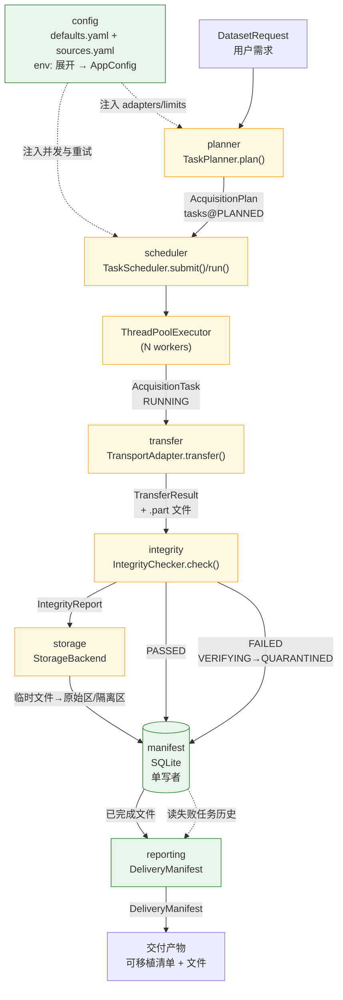

# 架构（Architecture）

ResearchDataHub 是一个**模块化单体（modular monolith）**：单个 Python 进程，模块之间通过
`core.ports` 中的 Protocol 解耦，通过依赖注入组装。不拆服务、不引入消息队列。
决策依据见 [`ADR-0001`](adr/ADR-0001-modular-monolith.md)。

本文描述：数据如何从“用户需求”流动到“可交付的数据文件”，以及在这个过程中
**线程、事务、异常、状态机**分别在哪里划界。

> **M0 状态说明**：本文描述的是**已经用代码固定的边界**（`core` 的模型、Protocol、状态机，
> 以及 `config` / `cli` 的实现）。`sources` / `transfer` / `scheduler` 等执行模块在 M0
> **只有接口、没有实现**（详见 [`docs/module-boundaries.md` §5](module-boundaries.md)）。
> 文中凡涉及执行行为的描述，都标注了它是"契约要求"还是"M0 已实现"。

---

## 1. 主数据流

一条采集请求的完整路径：

```
DatasetRequest
   │
   ▼
[planner]      源匹配、文件去重、未满足变量登记      → AcquisitionPlan
   │
   ▼
[scheduler]    入队、限流、线程池分发                → AcquisitionTask (QUEUED→RUNNING)
   │
   ▼
[transfer]     按 access_route 选适配器，搬运字节    → TransferResult + 临时文件
   │
   ▼
[integrity]    大小/校验和/格式/NetCDF 检查          → IntegrityReport
   │
   ▼
[storage]      原子移入原始区（只读）或隔离区        → FileRecord
   │
   ▼
[manifest]     SQLite：状态、事件、文件记录          → ManifestRepository
   │
   ▼
[reporting]    由已完成文件生成交付清单              → DeliveryManifest
```

### 1.1 mermaid 图



图例：绿色 = M0 已有实现；黄色 = M0 仅有契约（Protocol），实现在 M1。

### 1.2 纯文本降级说明

如果无法渲染 mermaid，上面的图等价于下面这段文字：

1. **入口**：`config` 子系统先加载 `configs/defaults.yaml` 与 `configs/sources.yaml`，展开 `env:VAR`
   引用，产出不可变的 `AppConfig` / `SourcesConfig`。它把"该用哪些 adapter、并发多少、重试几次"
   作为**参数**注入下游，而不是让下游自己去读配置文件。
2. **规划**：`config` 注入的 `DataSourceAdapter` 列表交给 `planner`，产出 `AcquisitionPlan`，
   其中的任务初始状态为 `PLANNED`。
3. **调度**：`scheduler` 把计划里的任务放进队列，按优先级出队，交给 `ThreadPoolExecutor` 的 N 个 worker。
   每个 worker 认领一个任务，任务转为 `RUNNING`。
4. **传输**：worker 调用 `TransportAdapter.transfer()`，按 `SourceAsset.access_route` 选择实现，
   把字节写入临时文件（`.part`），返回 `TransferResult`。
5. **校验**：传输成功后任务转 `VERIFYING`，`IntegrityChecker.check()` 返回 `IntegrityReport`。
6. **落盘**：`storage` 把临时文件原子移动到原始区（只读）或隔离区。产出 `FileRecord`。
7. **持久化**：`manifest` 把任务状态、事件、文件记录写进 SQLite。**这是唯一的事实来源**——
   不靠扫描文件夹判断完成。
8. **交付**：`reporting` 从 SQLite 读取已完成的文件记录，生成 `DeliveryManifest`。

反向的一条虚线：`reporting` 也读 SQLite，用于报告失败任务与重试历史。

---

## 2. 每个模块的职责

| 模块 | 一句话职责 | 明确不做 | M0 状态 |
|---|---|---|---|
| `core` | 定义数据契约、异常、状态机、模块接口 | 任何 I/O、任何具体数据源知识 | ✅ 完成 |
| `config` | 加载 YAML、展开 `env:`、严格校验 | 构造 `DatasetRequest`、访问网络、写文件 | ✅ 完成 |
| `sources` | 发现远端资产（目录查询 → `SourceAsset`） | **下载字节**、重试、落盘 | ⬜ 仅 Protocol |
| `transport` | 按访问路径搬运字节、断点续传、原子落盘 | 解析科学语义、源特有路径规则 | ⬜ 仅 Protocol |
| `storage` | 临时区/原始区/隔离区/归档区，原子移动，只读保护 | 校验内容、决定任务状态 | ⬜ 仅 Protocol |
| `integrity` | 只依赖元数据与字节执行完整性检查 | 信任远端声明、删除失败文件 | ⬜ 仅 Protocol |
| `manifest` | SQLite 持久化：状态、事件、文件记录 | 业务判断（只存事实） | ⬜ 仅 Protocol |
| `planner` | 需求 → 计划；源匹配、去重、未满足变量登记 | 执行、下载、改配置 | ⬜ 仅 Protocol |
| `scheduler` | 并发控制、优先级、重试预算、状态推进 | 传输实现、校验实现 | ⬜ 仅 Protocol |
| `catalog` | 数据集目录（声明式产品目录） | 运行时任务状态 | ⬜ 仅 Protocol |
| `reporting` | 把清单渲染成人读/机读报告 | 采集逻辑 | ⬜ 仅 Protocol |
| `cli` | 参数解析、调用、中文呈现、退出码 | 业务规则、校验规则 | ✅ M0 三命令 |

---

## 3. 依赖方向

```
cli ─► config ─► core
cli ─► core
执行层（sources/transfer/storage/manifest/integrity/planner/scheduler/catalog/reporting）
      ─► core（只依赖 Protocol 与模型）
      ✗ 互相不依赖
core ─► （无出边）
```

完整矩阵与检查脚本见 [`docs/module-boundaries.md` §3–§4](module-boundaries.md)。

### 3.1 禁止的跨模块调用

以下写法在代码评审中一律拒绝：

| ❌ 禁止 | 为什么 | ✅ 正确做法 |
|---|---|---|
| `scheduler` 里 `from researchdatahub.transfer.s3 import S3Transport` | 调度器与具体传输实现耦合，换协议要改调度器 | 接收 `TransportAdapter` 参数，按 `supports(asset)` 选择 |
| `transfer` 里判断 `if asset.source_id == "cds": ...` | 传输层含源特定逻辑，违反 ADR-0002 | 源特定规则放进 `SourceAsset.origin_uri` / `access_route` |
| `integrity` 里 `import researchdatahub.storage` | 校验层不该知道文件存在哪 | 只接收 `FileRecord` |
| `core` 里 `import researchdatahub.config` | 核心契约被配置格式污染 | 配置对象在 `config` 内，`core` 只认模型 |
| `planner` 里 `task.state = "RUNNING"` | 绕过状态机与审计 | `transition(task, TaskState.RUNNING, reason=...)` |
| `manifest` 里调用 `storage.publish_original()` | 持久化层不该有副作用 | 由 scheduler 编排顺序 |
| 两个执行模块互相 import | 形成横向耦合，最终变成隐式状态机 | 通过 `core.ports` 的 Protocol 通信 |

---

## 4. 同步 / 异步边界

这是最容易写错的地方。规则只有两条：

### 4.1 规则一：调度器内部是**同步 + 线程池**

`ports.py:11-12` 明确规定：

> 调度器在 `ThreadPoolExecutor` 中执行同步传输；异步适配器必须能够通过 `asyncio.run(...)`
> 包装成同步调用，或在事件循环内 `await`。

所以：

- **`TaskScheduler.run()` 是阻塞的同步方法**。它不返回 awaitable。
- **worker 线程里调用的是同步的 `TransportAdapter.transfer()`**，不是 `atransfer()`。
- 若某个传输实现本质是异步的（如 `cdsapi` 的某些新版接口），它在**自己的 `transfer()` 内部**
  用 `asyncio.run(self.atransfer(...))` 包装。对外仍暴露同步签名。

### 4.2 规则二：异步只出现在**单个适配器内部**

`TransportAdapter` 同时提供 `transfer()` 与 `atransfer()`（`ports.py:153-184`），
语义与异常**完全一致**。`ManifestRepository` 也提供 `aiter_tasks()`（`ports.py:402`）。

这两处异步能力的存在原因是：

- 某些客户端库（如 boto3 的替代品、httpx 的 async 模式）只在异步上下文可用；
- 未来的异步调度器（M2）可以复用同一批适配器。

**不允许**的是：

- 在 worker 线程里创建新的事件循环并长期持有；
- 把同步代码塞进 `async def` 里用 `time.sleep()` 而不是 `asyncio.sleep()`；
- 让一个 `async` 方法偷偷做阻塞 I/O。

### 4.3 线程模型示意

```
主线程                      ThreadPoolExecutor (workers=4)
  │                                  │
  ├─ scheduler.run()  ← 阻塞        ├─ worker-1: transfer(task A) → check → publish
  │    ├─ 从队列取任务               ├─ worker-2: transfer(task B) → check → publish
  │    ├─ submit 到线程池            ├─ worker-3: ...
  │    └─ 等待所有 future 完成       └─ worker-4: ...
  │                                  │
  └─ 完成后生成交付清单           每个线程：持有自己的 SQLite 连接
```

### 4.4 并发安全契约（逐模块）

| Protocol | 并发要求 | 原文位置 |
|---|---|---|
| `DataSourceAdapter` | 实例线程安全；`discover_assets` 可能被多 worker 并发调用 | `ports.py:64` |
| `TransportAdapter` | 单实例可被多线程并发 `transfer`；无可变共享状态或加锁 | `ports.py:138` |
| `CatalogProvider` | 只读线程安全；`upsert_dataset` 必须单线程调用 | `ports.py:198` |
| `TaskPlanner` | 无状态，可并发（依赖的 adapters 须线程安全） | `ports.py:220` |
| `TaskScheduler` | `submit`/`cancel` 多线程可调；队列线程安全 | `ports.py:247` |
| `IntegrityChecker` | 无状态实现应线程安全 | `ports.py:281` |
| `StorageBackend` | 可并发 `allocate_temp`；`publish_original` 必须原子 | `ports.py:311` |
| `ManifestRepository` | **连接不可跨线程共享**；写事务串行 | `ports.py:342` |

---

## 5. SQLite 写入边界

这是本架构中最需要纪律的部分。决策依据见 [`ADR-0003`](adr/ADR-0003-sqlite-manifest-source-of-truth.md)。

### 5.1 三条硬性规则

**规则 1：每个 worker 独立连接，绝不共享。**

SQLite 的 `sqlite3.Connection` 默认（`check_same_thread=True`）禁止跨线程使用。即便关掉这个检查，
多线程共享一个连接也会导致游标状态错乱。因此：**每个 worker 线程在启动时创建自己的连接，
在任务结束时关闭。**

```python
# 契约要求的形态（M1 实现），不是 M0 已有代码
def worker_loop(queue, repo_factory):
    with repo_factory() as repo:      # 本线程独立的连接
        while (task := queue.get()) is not None:
            ...
```

**规则 2：单写者 —— 写入串行化。**

同一时刻只允许一个写事务。两种实现方式（`ports.py:343` 明确允许二者之一）：

| 方式 | 做法 | 优点 | 缺点 |
|---|---|---|---|
| **单写者队列** | 一个专用线程消费写队列，其余线程把"写意图"投递进去 | 绝不会 `database is locked` | 写延迟略增 |
| **`BEGIN IMMEDIATE` + 重试** | 每个写事务先拿写锁，冲突时按退避重试 | 实现简单 | 高并发时有忙等 |

**推荐单写者队列**：科研采集的写入频率远低于传输频率（每个任务几次写），队列不会成为瓶颈，
而"绝不出现 `database is locked`"这个保证值钱。

**规则 3：状态与事件同事务。**

`ports.py:347` 规定：

> `save_task` + `append_event` 必须落在同一事务内，避免"状态变了但没记事件"。

这意味着 manifest 实现必须能接受"一批操作"作为一个原子单元，而不是两个独立方法各自提交。
若接口只有两个独立方法，调用方必须在同一事务上下文内调用二者（例如 `repo.transaction()` 上下文管理器）。

### 5.2 乐观并发控制

`save_task(task, *, expected_state=...)`（`ports.py:354`）提供版本校验：

```
worker A: load_task("t1") → state=RUNNING, 准备写 COMPLETED
worker B: load_task("t1") → state=RUNNING, 准备写 FAILED
worker A: save_task(task, expected_state=RUNNING)  ✅ 写入，实际状态变为 COMPLETED
worker B: save_task(task, expected_state=RUNNING)  ❌ 数据库中已是 COMPLETED → ManifestError
```

没有这个参数，两个 worker 会互相覆盖，最终状态取决于谁先提交——这在科研数据里是不可接受的
不确定性。

### 5.3 为什么不能靠扫描文件夹判断完成

详细论证见 ADR-0003。核心一句：**文件存在 ≠ 数据可用**。存在但截断的文件、校验失败后残留的
半成品、被用户手工删掉的文件，都会让目录扫描给出错误结论。SQLite 记录的是"我们**确认**完成了什么"，
这需要校验通过的证据，而文件系统本身不携带证据。

### 5.4 写入边界总结

| 谁写 | 写什么 | 频率 |
|---|---|---|
| worker 自己的连接 | `save_task`（状态推进）、`append_event` | 每任务几次 |
| 单写者线程 / 事务 | 上二者合并提交 | 串行 |
| 主线程 | `build_delivery_manifest`（**只读**） | 每次采集 1 次 |
| `initialize()` | DDL（建表/迁移） | 进程启动 1 次，幂等 |

---

## 6. 配置流

### 6.1 两个配置文件

| 文件 | 顶层 key | 管什么 | 是否入库 |
|---|---|---|---|
| `configs/defaults.yaml` | `defaults:` | 存储根、并发、重试、完整性默认检查、日志 | ✅ 是（示例无凭证） |
| `configs/sources.yaml` | `sources:` | 数据源声明、传输绑定、端点、限额 | ❌ 被 `.gitignore` 忽略 |

`configs/sources.example.yaml` 是后者的模板，**不含任何真实凭证**。

### 6.2 加载链

```
YAML 文本
   │  yaml.safe_load
   ▼
原始 dict（object）
   │  detect_config_kind()  ← 依据顶层 key 判断 defaults / sources
   ▼
resolve_env_refs()   ← 展开 env:VAR 与 ${VAR}，缺失即 ConfigError
   ▼
Pydantic 模型（frozen=True, extra="forbid"）
   ▼
AppConfig / SourcesConfig
   ▼
注入到 planner / scheduler / adapter 构造函数
```

关键点：

- **`env:` 引用在加载时展开**，未设置的变量立刻报错并**点名是哪个变量、在哪一行**
  （`configs/defaults.yaml` 头部注释描述了三种写法：`~/.rdh`、`env:RDH_HOME`、`${RDH_HOME}/s`）。
- **`extra="forbid"`**：配置文件里多写一个未知键会直接校验失败，不会静默忽略。
  这与 `core` 模型的严格性一致。
- **配置对象不可变**：加载完成后，外部修改原始 dict 不会影响已加载对象。

### 6.3 M0 的真实验证路径

```bash
# 缺环境变量 → 退出码 1，并逐条点名
PYTHONPATH=src .venv/bin/python -m researchdatahub.cli.main config validate

# 补齐后 → PASS，退出码 0
export RDH_HOME="$HOME/.rdh" CDSAPI_KEY="..."
PYTHONPATH=src .venv/bin/python -m researchdatahub.cli.main config validate
```

### 6.4 配置 → 运行时的映射

| 配置项 | 影响谁 | 对应契约 |
|---|---|---|
| `defaults.storage.root` | `StorageBackend` 的根目录 | `manifest` 的 DB 路径也在其下 |
| `defaults.concurrency.workers` | `ThreadPoolExecutor(max_workers=...)` | — |
| `defaults.concurrency.per_source_limit` | 每源信号量 | 避免触发 RDA/CDS 限额 |
| `defaults.retry.max_attempts` | `AcquisitionTask.max_attempts` 的默认值 | `models.py:496`（默认 3，上限 32） |
| `defaults.retry.retry_on` | 异常 → `RetryableTransportError` 的映射 | `errors.py:194` |
| `defaults.integrity.default_checks` | `DatasetRequest.checks` 的默认来源 | `models.py:432` |
| `sources.<id>.adapter` | 实例化哪个 `DataSourceAdapter` | `ports.DataSourceAdapter` |
| `sources.<id>.transports[].route` | 该源可用的访问路径 | `SourceConfig.routes` → `AccessRoute` |
| `sources.<id>.implemented` | `source list` 的展示与 M1 的启用开关 | — |

---

## 7. 错误传播与状态机联动

### 7.1 异常 → 状态

异常层次（`errors.py`）不是装饰，它直接决定任务下一步去哪：

```
        发生位置         异常类型                          目标状态
        ─────────        ────────                          ────────
  transfer 超时/连接重置  RetryableTransportError(429/5xx)   RETRY_WAIT
  transfer 404/403       PermanentTransportError           FAILED
  transfer 磁盘满         StorageError                      FAILED
  integrity 校验失败      IntegrityReport(status=FAILED)    QUARANTINED
  integrity 无法进行      IntegrityError                    QUARANTINED
  manifest 版本冲突       ManifestError                     中止当前任务（不推进状态）
  planner 无源支持        SourceNotFoundError                FAILED（或整体拒绝）
  scheduler 并发非法      ScheduleError                     拒绝 run()，不启动任何任务
  state 非法转换          StateTransitionError              保持原状态（异常本身即证明未转换）
```

**关键区分**：`IntegrityChecker.check()` 的校验失败**返回** `IntegrityReport(status=FAILED)`，
不抛异常（`ports.py:293`）。"数据不合格"是正常业务结果，不是程序错误。只有"检查无法进行"
（如文件不存在却有待检记录）才抛 `IntegrityError`。

### 7.2 状态机的物理强制

状态不能任意跳。`TRANSITIONS` 表（`state.py:116`）是唯一事实来源，实测输出：

```
PENDING      -> CANCELLED, FAILED, PLANNED, SKIPPED
PLANNED      -> CANCELLED, FAILED, QUEUED, SKIPPED
QUEUED       -> CANCELLED, FAILED, PAUSED, RUNNING, SKIPPED
RUNNING      -> CANCELLED, FAILED, PAUSED, RETRY_WAIT, VERIFYING
VERIFYING    -> CANCELLED, COMPLETED, FAILED, QUARANTINED, RETRY_WAIT
RETRY_WAIT   -> CANCELLED, FAILED, PAUSED, QUEUED
COMPLETED    -> (terminal)
FAILED       -> (terminal)
PAUSED       -> CANCELLED, FAILED, QUEUED
CANCELLED    -> (terminal)
SKIPPED      -> (terminal)
QUARANTINED  -> (terminal)
```

> 以上输出由 `describe_transitions()` 直接生成，是 12 态 × 12 态共 144 组组合中的
> **30 条合法边**（其余 114 组含自环一律非法）。5 个终态：`COMPLETED` / `FAILED` /
> `CANCELLED` / `SKIPPED` / `QUARANTINED`。
>
> **`FAILED` 是纯终态**（`TRANSITIONS[FAILED] == frozenset()`）。唯一的例外是**事后审计**：
> 历史失败任务的产物后来被发现损坏时，允许 `FAILED → QUARANTINED`，但必须显式传
> `after_integrity=True`（`can_transition(..., after_integrity=True)` 与
> `transition(..., after_integrity=True)`，见 [`state.py:169`](../src/researchdatahub/core/state.py#L169)
> 与 [`state.py:211`](../src/researchdatahub/core/state.py#L211)）。
> 这样常规路径无法走到该边，避免"`FAILED` 既是终态又有出边"的自相矛盾。
>
> 自环（`X -> X`）一律非法：`can_transition(X, X) is False`，因为它不代表一次真正的状态推进。

三条最重要的结构性约束：

1. **`RUNNING` 不能直接到 `COMPLETED`**（`state.py:132` 注释："Integrity Before Delivery"）。
   必须先经过 `VERIFYING`。这条规则让"没校验就交付"在物理上不可能发生。
2. **`COMPLETED` 只能从 `VERIFYING` 进入**，且 `transition()` 里有额外的业务前提检查
   （`state.py:260`），即使有人篡改了 `TRANSITIONS` 表也会被拦下。
3. **`QUARANTINED` 是终态**：隔离的文件不会自动复活，必须重新规划产生新任务。

### 7.3 重试链路

```
RUNNING --失败(可重试)--> RETRY_WAIT --(attempt < max_attempts)--> QUEUED --> RUNNING
                                     --(attempt >= max_attempts)--> FAILED
```

`attempt` 在**进入 `RUNNING` 时 +1**（`state.py:290`）。所以 `RETRY_WAIT → QUEUED` 时若
`attempt >= max_attempts`，`transition()` 抛 `StateTransitionError` 并提示"transition to FAILED instead"
（`state.py:255-267`）。调用方应该先调 `next_state_after_failure(task)` 决定目标。

### 7.4 崩溃恢复

进程异常退出时，任务可能卡在 `RUNNING` 或 `VERIFYING`。恢复流程：

```
is_stale(task, timeout_seconds=3600)   ← last_transition_at 或 started_at 起算
   │ True
   ▼
recover_stale(task)
   ├─ state=VERIFYING → RETRY_WAIT（重做校验）
   ├─ state=RUNNING 且 attempt < max → RETRY_WAIT
   └─ state=RUNNING 且 attempt >= max → FAILED
```

`is_stale()` 只对 `RUNNING` / `VERIFYING` 可能返回 `True`（`state.py:325`）。
没有时间戳的任务**直接视为过期**——"无法自证的运行中任务不应被信任"（`state.py:320`）。

### 7.5 错误可观测性

每个 `RdhError` 携带 `code`、`task_id`、`source_id`、`detail`，并提供 `to_dict()`。
`detail` 必须可 JSON 序列化，以便写入 Manifest 的 `last_error` 字段（`models.py:501`，上限 2048 字符）。

CLI 层（`cli/_console.py`）只把 `RdhError` 渲染为中文可读信息并给出非零退出码，
**不打印 traceback**；非预期异常不拦截，让它带着 traceback 冒出去——那属于缺陷，不能被吞掉。

---

## 8. M0 的真实边界

为了避免读者高估当前能力，这里明确区分：

| 能力 | M0 实际状态 | 证据 |
|---|---|---|
| 契约定义（10 模型 / 13 异常 / 12 态 / 8 Protocol） | ✅ 可用 | `src/researchdatahub/core/` |
| 配置加载与校验 | ✅ 可用 | `rdh config validate` |
| CLI 骨架与未实现拒绝 | ✅ 可用 | `plan`/`fetch`/`status` 退出码 2 |
| 数据集发现 | ❌ 无实现 | `sources/__init__.py` 仅 docstring |
| 字节传输 | ❌ 无实现 | `transfer/__init__.py` 仅 docstring |
| 完整性检查 | ❌ 无实现 | `integrity/__init__.py` 仅 docstring |
| SQLite Manifest | ❌ 无实现 | `manifest/__init__.py` 仅 docstring |
| 报告生成 | ❌ 无实现 | `reporting/__init__.py` 仅 docstring |

**M0 不会下载任何字节。** 这一点由 `_stubs.py` 强制：`fetch` 命令直接抛
`NotImplementedFeatureError` 并以退出码 2 结束。

---

## 9. 相关文档

- 数据契约细节：[`docs/data-contract.md`](data-contract.md)
- 模块 API 与依赖规则：[`docs/module-boundaries.md`](module-boundaries.md)
- 为什么是单体：[`docs/adr/ADR-0001-modular-monolith.md`](adr/ADR-0001-modular-monolith.md)
- 为什么源与传输分离：[`docs/adr/ADR-0002-source-transport-separation.md`](adr/ADR-0002-source-transport-separation.md)
- 为什么用 SQLite 做事实来源：[`docs/adr/ADR-0003-sqlite-manifest-source-of-truth.md`](adr/ADR-0003-sqlite-manifest-source-of-truth.md)
- 测试策略：[`docs/testing-strategy.md`](testing-strategy.md)
