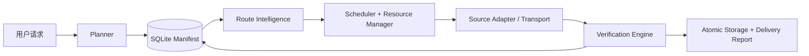

# RDH 目标架构

## 数据流

## 职责

- `core` 定义 Manifest、Task、Route、Integrity 和状态迁移。
- `environment` 负责本机能力、网络与存储探测。
- `routing` 维护可验证路线、性能历史、资格状态与选择原因。
- `sources` 将数据源 API 标准化为资产和元数据。
- `planner` 将一个科研需求拆为可去重的任务集合。
- `scheduler` 统一并发、速率、租约、重试与恢复，支持本地模式和可插拔 Agent dispatcher。
- `transfer` 统一 HTTP/S3 字节搬运。每次响应流式读取并受 400 MiB 硬上限约束，大文件通过经过验证的 Range 或自然数据维度拆分。
- `integrity` 执行文件、任务、科研内容和跨路线四层验证，并产出缺失项。
- `manifest` 是状态事实源，长期记忆只保存环境与路线经验，不保存凭据。

CDS 仅在其他符合要求的路线不存在、不可用或无法满足数据完整性时作为回退。路线选择必须持久化候选、失败原因、评分和最终决策。
